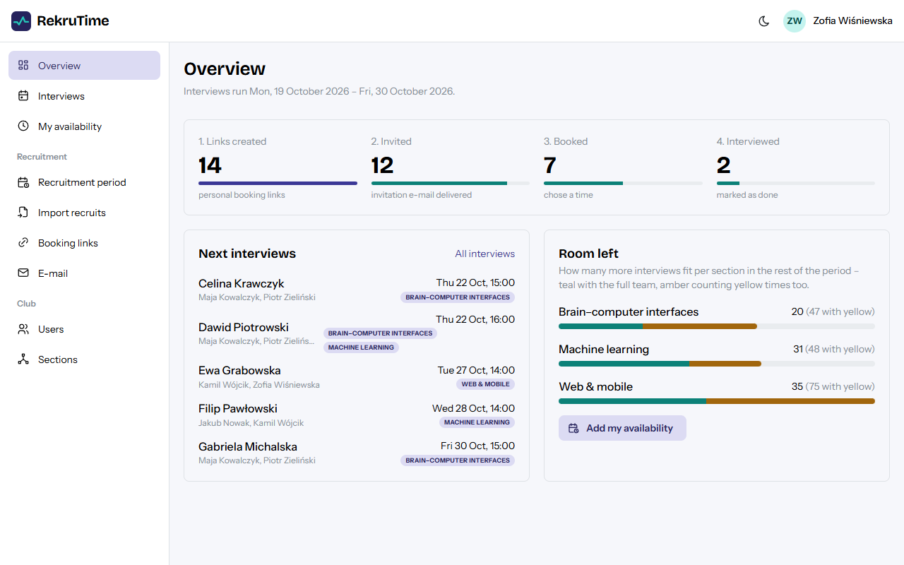
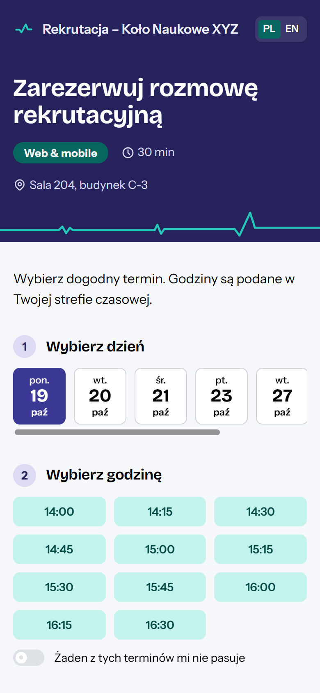
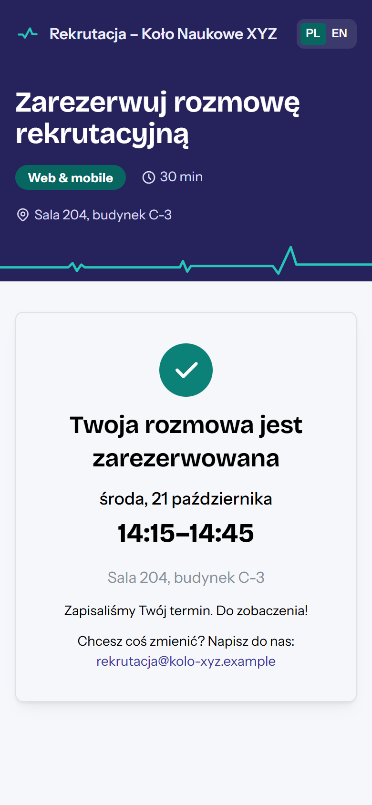
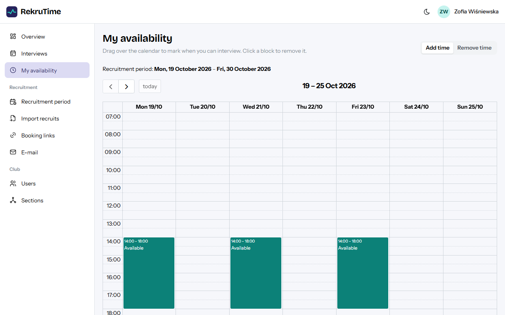
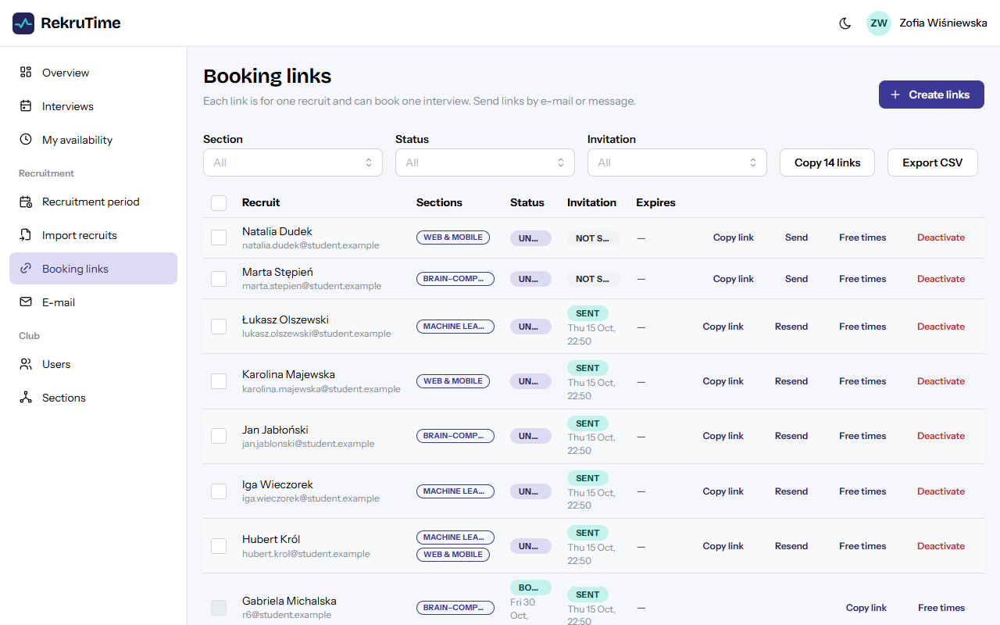
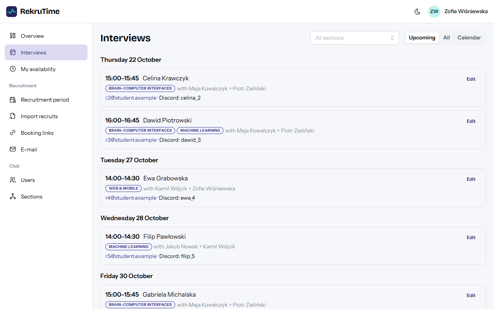
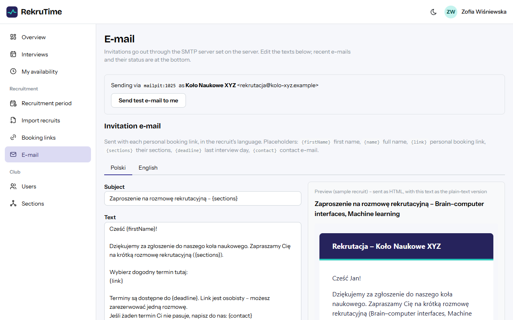
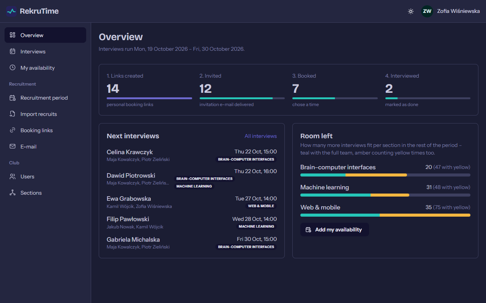
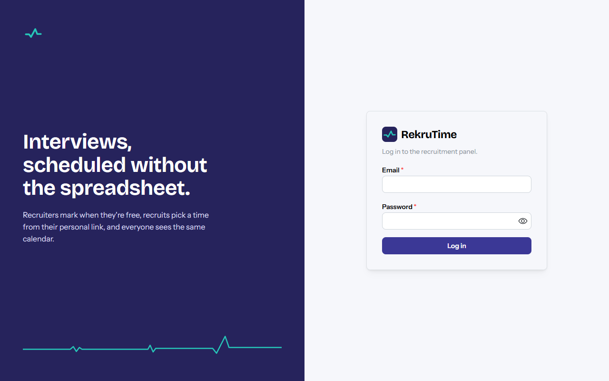

<p align="center">
  
</p>

<h1 align="center">RekruTime</h1>

<p align="center">
  Recruitment interview scheduling for student science clubs.<br />
  Recruiters mark when they're free, every recruit gets a personal link and picks a time – no spreadsheets, no double bookings.
</p>

<p align="center">
  
</p>

## How it works

1. **Set up** – an admin creates the club's sections (e.g. *Machine learning*, *Web & mobile*), recruiter accounts and the interview period.
2. **Availability** – recruiters drag over a calendar to mark when they can interview.
3. **Invite** – import recruits from a Google Forms export (CSV / pasted table). Each recruit gets a personal booking link by e-mail, in Polish or English.
4. **Book** – the recruit opens the link on their phone and picks a time. Only times when interviewers from *their* sections are free are offered.
5. **Interview** – everyone sees their interviews; admins see all of them and can move, reassign, cancel or mark them done.
6. **Clean up** – after the recruitment, delete all recruit data in one step (GDPR).

<table>
  <tr>
    <td width="33%"></td>
    <td width="33%"></td>
    <td><br /><br /></td>
  </tr>
</table>

## Features

- **Smart slots** – a time is *green* when at least two interviewers are free and every section the recruit applied to is represented, *yellow* when only one person can cover it (shown only if the recruit says none of the green times suit them). Interview length and a buffer between interviews are set per section; interviews are spread across recruiters by load.
- **No double bookings** – one room; overlapping interviews are rejected by a database constraint, so two recruits clicking the same time at once can't both get it.
- **Personal links** – 128-bit tokens, one interview per link, optional expiry, can be deactivated. The public page needs no login and is rate-limited.
- **Import & invitations** – paste or upload the Google Forms export, map columns, preview, then create links and queue invitations in one go. Re-importing skips people who already have a link.
- **E-mail** – any SMTP server; HTML invitation with a plain-text alternative, editable texts per language with placeholders and a live preview, background outbox with retries and visible status. See [docs/EMAIL.md](docs/EMAIL.md).
- **Overview dashboard** – links created → invited → booked → interviewed, next interviews, how many more interviews still fit per section.
- **Roles** – *Admin* (manages everything, counts as an interviewer for every section) and *Recruiter* (own availability and interviews). No public registration.
- **Privacy** – consent on booking, per-recruit delete and a full purge after the recruitment.
- **Bilingual booking page** (Polish default, English), English admin panel, light and dark mode, works on phones.

<details>
<summary>More screenshots</summary>

| | |
|---|---|
|  |  |
|  |  |

</details>

## Tech stack

| | |
|---|---|
| Backend | ASP.NET Core 10 (minimal APIs), EF Core 10 + Npgsql, ASP.NET Core Identity (cookie auth), MailKit |
| Database | PostgreSQL 17 |
| Frontend | React 19, TypeScript, Vite, Mantine 9, TanStack Query, React Router, FullCalendar |
| Tests | xUnit + Testcontainers (real Postgres and Mailpit) |
| Deployment | One Docker image (API serves the built frontend), Docker Compose, optional Caddy for HTTPS |

## Local development

Requirements: Docker, .NET 10 SDK, Node 24.

```bash
# 1. Database (Postgres on port 5440) + Mailpit (catches all e-mails)
docker compose up -d

# 2. Backend – http://localhost:5080, API docs at /scalar. Migrations run on startup.
ASPNETCORE_ENVIRONMENT=Development dotnet run --project backend/RekruTime.Api --no-launch-profile --urls http://localhost:5080

# 3. Frontend – http://localhost:5173 (proxies /api to the backend)
cd frontend && npm install && npx vite
```

Log in with the dev admin **`admin@rekrutime.local` / `Admin123!`** (from `appsettings.Development.json`).
Every e-mail the app sends lands in Mailpit: <http://localhost:8025>.

Postgres runs on **5440** on purpose, so it doesn't clash with a locally installed one on 5432.

### Tests

```bash
cd backend && dotnet test        # needs Docker running (Testcontainers)
cd frontend && npm run build && npm run lint && npm test
```

Unit tests cover the pure logic (slot algorithm, voting rules, e-mail texts, calendar files). Integration tests run the
real API against Postgres: one container per run, a fresh database per test (`RekruTime.Tests/Infrastructure/TestApp.cs`),
in a `Testing` environment so local dev settings never leak in. They cover every feature end to end through HTTP,
concurrent bookings, the e-mail outbox against a real SMTP server (Mailpit), and an authorization matrix that checks every
endpoint for anonymous / recruiter / section leader / admin – a new endpoint fails it until it gets a row.

GitHub Actions (`.github/workflows/ci.yml`) runs both on every pull request.

### Database migrations

```bash
cd backend && dotnet tool restore
dotnet ef migrations add <Name> --project RekruTime.Api -o Data/Migrations
```

## Configuration

All settings come from configuration – in production from environment variables (`Section__Key`, double underscore), in development from `appsettings.Development.json`. Nothing secret is stored in the database or the repo. The full list with examples is in [`.env.example`](.env.example).

| Setting | Default | Description |
|---|---|---|
| `ConnectionStrings__Default` | – | Postgres connection string (set by `docker-compose.prod.yml`) |
| `SeedAdmin__Email`, `SeedAdmin__Password`, `SeedAdmin__DisplayName` | – | First admin, created on startup only if no admin exists |
| `Club__Name` | – | Shown on the booking page and in the e-mail header ("Rekrutacja – {name}") |
| `Club__PublicUrl` | – | Public address of the app; required for links in e-mails |
| `Club__ContactEmail` | – | Shown to recruits (`{contact}` in e-mails, booking page) |
| `Club__InterviewLocation` | – | Where interviews take place |
| `Club__TimeZone` | `Europe/Warsaw` | Time zone of the recruitment dates |
| `Email__Host`, `Email__Port`, `Email__Security` | –, `587`, `StartTls` | SMTP server; empty host = e-mail disabled (links can still be copied or exported) |
| `Email__Username`, `Email__Password` | – | SMTP login |
| `Email__FromAddress`, `Email__FromName`, `Email__ReplyTo` | –, `Rekrutacja`, – | Sender and reply address |
| `Email__DelayBetweenMessagesMs` | `3000` | Pause between e-mails (provider rate limits) |
| `DataProtection__KeysPath` | `/keys` in the image | Where login-cookie keys are stored (a volume, so logins survive redeploys) |

E-mail provider setup (Gmail app passwords, Brevo relay, reply-to the university address): [docs/EMAIL.md](docs/EMAIL.md).

## Deployment

The image `ghcr.io/infotcube/rekrutime` is built by GitHub Actions on every push to `main`.

```bash
cp .env.example .env    # fill in passwords, admin, club and e-mail settings
docker compose -f docker-compose.prod.yml up -d                   # behind your own reverse proxy → 127.0.0.1:8080
docker compose -f docker-compose.prod.yml --profile caddy up -d   # or: Caddy with automatic HTTPS for DOMAIN
```

Updating is `docker compose -f docker-compose.prod.yml pull && docker compose -f docker-compose.prod.yml up -d`.
Reverse-proxy options, health check, backups and rollback: [docs/DEPLOY.md](docs/DEPLOY.md).

## Project structure

```
backend/
  RekruTime.Api/
    Program.cs              service registration, middleware, endpoint mapping
    Common/                 options (Club), Result → HTTP mapping
    Data/                   DbContext, entities, migrations, seed
    Features/<Feature>/     *Endpoints.cs (thin HTTP layer) + *Service.cs (logic)
      Booking/              SlotCalculator (pure slot algorithm), links, import, public booking
      Email/                outbox sender, invitation templates, HTML layout
  RekruTime.Tests/          xUnit + Testcontainers
frontend/
  src/
    theme.ts, theme.css     visual identity (colours, fonts) – change the look here
    pages/                  booking page, login, availability, interviews
    pages/admin/            overview, import, links, e-mail, users, sections, period
    locales/                booking page texts (pl, en)
docs/                       PLAN.md, EMAIL.md, DEPLOY.md, screenshots
Dockerfile                  one image: React build + API
docker-compose.yml          local dev: Postgres + Mailpit
docker-compose.prod.yml     production: app + Postgres (+ optional Caddy)
```

## Docs

- [docs/PLAN.md](docs/PLAN.md) – implementation plan, domain rules (slot colours, buffers, booking rules) and later phases (interview notes and approvals, own recruitment forms, more mailing)
- [docs/EMAIL.md](docs/EMAIL.md) – setting up e-mail sending
- [docs/DEPLOY.md](docs/DEPLOY.md) – production deployment with Docker
